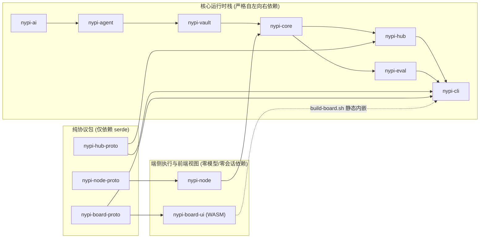
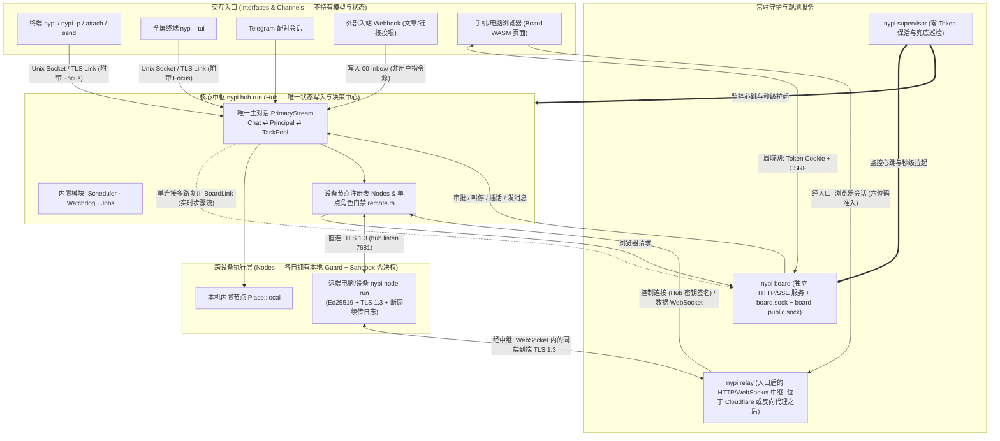

# NyPi 项目全景说明书

本文档基于当前仓库最新源码（12 个 Rust Crate，约 8.8 万行代码）编写，**只描述当前真实生效的系统全貌，不夹杂已淘汰的历史过渡方案**，用于一文看清整个项目的定位、结构、运行机制、存储设计与安全边界。

---

## 一、 项目定位与五条工程底线

**NyPi** 是一个用 Rust（2024 Edition，Tokio 异步运行时）从零编写、编译为**单一无外部运行时依赖二进制文件（`nypi`）**的个人常驻智能体框架（默认智能体名为 **Lucia**）。

上游参考项目 `../Pi`（TypeScript）解决的是“人在终端前敲一句命令、模型在当前目录改一次代码”的交互式编程问题；而 NyPi 要解决的是**构建一个 24/7 在线、跨多台设备、能长期推进复杂目标并替用户把关风险的个人幕僚长**。

整套代码围绕五条写死在机制里的底线展开（对应 [principles.md](principles.md)）：

1. **行动链绝不静默中断（B6）**：任何任务绝不允许悄无声息地停掉。每次运行必须以 `Done`、`Blocked`、`Failed`、`Continuing` 之一收尾；后台每项激活也必须给出明确处置结果。进程崩溃有看门狗（`Watchdog`）恢复，无人值守时的结果先进发件箱（`Outbox`）保底重试投递。
2. **说话、决策、执行三层分离（D84）**：前台 `Chat` 负责秒回对话与只读查询，绝不直接改东西；后台 `Principal` 用最强模型做规划、管状态、派任务与独立验收，绝不直接对用户说话；任务池中的 `Worker` 与专业代理（`Specialist`）负责动文件、跑命令与联网。对外始终表现为同一个连贯身份。
3. **监管独立于模型之外（A1 / R5）**：审计、敏感操作审批（`Inspector`）与受保护路径拦截（`Guard` + 操作系统内核沙盒）全部运行在宿主代码中。智能体无法修改自己的核心规则、审计日志、账本与密钥文件。
4. **机密可用但不可见（D76 / D77 / D87）**：环境变量文件进入私有表，绝不导出给子进程；业务密码与 Token 密封在机密库中，模型只能看到引用句柄（`cred://scope/name`），由宿主工具在请求发出时代填，且所有工具返回、平面日志与网页看板输出均经实时脱敏器（`LiveScrubber`）清洗。
5. **单中枢、多设备节点、薄界面（D66 / D79 / D80）**：全系统只有一个 `Hub` 持有对话、模型密钥与状态存储；每台电脑或手机只运行无模型代码的执行节点（`Node`）或交互界面（`Interface`），从根源避免多端状态冲突与密钥散落。

---

## 二、 仓库分层与 12 个 Crate 职责表

仓库只包含纯 Rust 工作区，严格遵循**自左向右单向依赖**（左侧包绝不依赖右侧包）。端侧执行包与前端页面包被完全隔离在模型与会话代码之外，确保可独立编译到移动端与浏览器 WebAssembly：



| Crate | 核心职责与包含内容 | 关键入口文件 |
| :--- | :--- | :--- |
| **nypi-ai** | 统一消息与流事件枚举、零厂商 SDK 的五大模型协议适配（Anthropic、OpenAI Chat、OpenAI Responses、Gemini、Bedrock SigV4 二进制流、测试用 `faux`）、`candle` 本地量化 `Qwen3-Embedding-0.6B` 向量计算（权重与分词器均固定 SHA-256 校验） | `crates/nypi-ai/src/lib.rs` |
| **nypi-agent** | 纯粹的多轮状态机：请求模型 → 并行/串行执行工具 → 处理前后钩子（`ToolHooks` / `TurnHooks`）→ 排空插话（`steering`）与追问（`follow_up`）队列 | `crates/nypi-agent/src/agent.rs` |
| **nypi-vault** | 持久化存储层：追加写 JSONL 增量折叠器 `Folded<S>`、情景记忆库、自带 Markdown 金库与双向链接检索索引、资产台账 `AssetRegistry`、`ChaCha20-Poly1305` 机密库与 `LiveScrubber` | `crates/nypi-vault/src/lib.rs` |
| **nypi-node-proto** / **nypi-node** | Hub 与设备节点之间的调用协议（`Call` / `Cancel` / `Output` / `Finished` / `Refused`）及单设备工具表、本地门禁、断网租约续传日志 `journal.rs` | `crates/nypi-node/src/link.rs` |
| **nypi-core** | 核心智能体引擎：`Chat` / `Principal`（`principal/`） / `TaskPool` 三平面、四层上下文组装 `briefing.rs`、证据核验 `evidence.rs`、长期项目 `campaign.rs`、跨端场所 `place.rs`、安全监管 `inspector.rs` / `sandbox.rs`、MCP 客户端、专家委派 `specialist.rs`、反思与画像 | `crates/nypi-core/src/lib.rs` |
| **nypi-hub-proto** / **nypi-hub** | 常驻中枢：全局唯一主对话 `PrimaryStream`、前后端协议循环 `chat_loop.rs` / `rpc.rs`、设备注册表 `nodes.rs`、双向 TLS 1.3 确认码准入 `pairing.rs`、跨网中继与直连选路 `relay.rs` / `reach.rs`、统一渠道 `channels/`（Telegram 与入站 Webhook）、后台定时器与看门狗调度 | `crates/nypi-hub/src/lib.rs` |
| **nypi-board-proto** / **nypi-board-ui** | Web 实时监控看板的前后端通信结构与 Rust + Leptos 编写的 WebAssembly 单页应用 | `crates/nypi-board-ui/src/lib.rs` |
| **nypi-eval** | 离线沙盒评测框架：内置本地故障注入 HTTP 服务器 `FaultServer`，客观检查磁盘与请求结果，支持单层 Worker 与 `--three-planes` 三层全链路评测 | `crates/nypi-eval/src/lib.rs` |
| **nypi-cli** | 最终生成单一 `nypi` 二进制文件：包含行终端、Ratatui 全屏 `--tui`、后台守护 `supervisor`、Web 看板服务端 `board/` 及全部管理子命令 | `crates/nypi-cli/src/main.rs` |

---

## 三、 运行进程与多设备网络拓扑

系统按职责拆成六个清晰的运行角色，无论是否安装后台常驻服务，内部走的都是同一套协议循环：



### 关键拓扑机制

1. **全局唯一主对话（`PrimaryStream`）与环境焦点（`Focus`）**
   不再按文件夹切分孤立会话。无论你在哪个目录敲 `nypi`、在手机发 Telegram 还是在网页看板发消息，接入的都是同一个连续会话（`sessions/primary`）。每个客户端发消息时只附带当前的环境焦点 `Focus { device, folder }`（代表“用户此刻站在这台设备的这个目录里说话”）。哪怕没启动常驻的 `hub` 直接单次运行，`CLI` 也会在进程内启动同构的内存微型 `Hub`（`daemon::Local`），行为完全一致。
2. **跨设备调用路由（`Place`）与受控目录上下文**
   基础设备工具（`read`、`write`、`edit`、`bash`、`grep`、`find`、`ls`）均支持按次指定 `folder` 和可选的 `device`（特殊设备独占工具通过 `on_device` 调用）。每次调用先由 Hub 的 `Inspector` 按**目标设备的主目录与信任规则**做策略与审批检查，再发往目标设备的 `Node`，由该设备本地的 `Guard` 和内核沙盒做二次把关。远端受信任目录的 `AGENTS.md`、技能、原生专家及白名单运行参数自动同步生效，但远端配置绝不能关闭或削弱 Hub 的安全与审批规则。
3. **两种实例与经用户确认的加入（`instance.rs`、`pairing.rs`，D93）**
   每台机器要么是 Hub，要么是某个 Hub 的节点，由 `~/.nypi/instance.json` 记录（模式、名称、实例 ID、任期 `epoch`、信任的 Hub 公钥指纹、信任级别）；同一个 `supervisor` 服务（macOS LaunchAgent 或 Linux systemd 用户单元）按模式保活对应进程。新机器执行 `nypi node up`：在同一局域网内通过 mDNS 找到 Hub，不在同一网络时使用用户自己的入口（`--entry nypi.example.com:443`，写入 `settings.json` 并在之后每次升级中保留；公开构建默认没有内置入口，D97）找到 Hub，双方用两把公钥指纹与 TLS 导出值（RFC 5705）算出同一个六位确认码；Hub 把加入请求推送到终端、Telegram 与看板，用户核对码一致后选择 **`personal`**（本人电脑，可执行调用也可对话）或 **`exec-only`**（只执行调用）。请求 10 分钟过期，同时最多 3 个、单 IP 每天 10 个、全天 30 个，且绝不进入对话或唤醒 `Principal`；`nypi devices invite` 可发一次性邀请码。每台机器只有一把密钥；连接首行声明用途（`node` / `talk` / `join` / `leave` / `probe`），由 `daemon/remote.rs` **只按准入信任级别与用途**分流：节点连接永远只按节点协议读取，`talk` 只对 `personal` 机器开放；`nypi devices remove` 会立即切断其存活连接。
4. **直连优先、中继兜底（`reach.rs`、`direct.rs`、`mdns.rs`、`relay.rs`，D94）**
   Hub 在 `hub.listen`（默认 `0.0.0.0:7681` 与 `[::]:7681`）直接接受机器连接，并每 10 秒整理自己的直连候选地址（各网卡私网 IPv4、全局或唯一本地 IPv6、用户在路由器转发的 `hub.publicAddress`、以及开启 `hub.portMapping` 后经 NAT-PMP/UPnP-IGD 映射的端口），在 `Welcome` 中下发并在变化时推送给节点；同时在局域网用 mDNS（`_nypi._tcp`，TXT 带公钥指纹与 `epoch`）广播自己。节点每次连接先并发探测 mDNS 听到的 Hub 与已知候选地址（同网段优先、上次成功的最先），只有 TLS 握手出示**已固定的 Hub 公钥**才算数，同钥多个 Hub 取最高 `epoch`，低于已知 `epoch` 的一律拒绝；1.5 秒内无直连则走入口。经中继连接的节点每分钟重试直连，一旦成功即切换，进行中的调用由节点日志接续。入口背后的 **`nypi relay`** 是普通的 HTTP/1.1 + WebSocket 服务（默认 `127.0.0.1:7682`），放在 Cloudflare Tunnel、Cloudflare 代理或 Nginx/Caddy 之后，VPS 无需公网端口、IP 不暴露：`/_nypi/hub` 是 Hub 用密钥签名挑战建立的控制连接，`/_nypi/link` 把机器的 WebSocket 与 Hub 回拨的数据 WebSocket 逐帧拼接，**帧内仍是两端密钥之间的同一套端到端 TLS 1.3**，中继与 Cloudflare 都读不到、也冒充不了任何一端；其余路径是浏览器请求，交给 Hub 再转到看板的 `run/board-public.sock`。中继限制每 IP 每分钟连接数、等待数、请求大小与每条链路带宽，没有 Hub 注册时拒绝链接、对浏览器回 503，只保存 Hub 指纹、`epoch` 与实例 ID。手机打开 `https://nypi.example.com` 时看板只给出带六位码的准入页（绝不暴露 `/api/*`），用户在可信处批准后才发放 `HttpOnly`/`Secure`/`SameSite=Strict` 会话 Cookie（注册表只存其哈希），`nypi devices remove` 立即结束该会话及其实时流。
5. **Hub 可迁移、任何时刻只有一个 Hub（`state.rs`、`standby.rs`、`daemon/handover.rs`，D95）**
   每台 `personal` 节点保留一份 Hub 状态的**热备副本**（`~/.nypi/standby/`，任何工具不可读）：即整个 NyPi 主目录去掉只属于单台机器的部分（`run/`、`logs/`、`bin/`、`models/`、`node/`、设备密钥、`instance.json` 等），包含会话、Vault、任务账本、目标、存储、设备注册表、Hub 密钥、加密秘密库及其主密钥、以及设置中列出的环境文件（主目录外的放到 `env/<名称>`）。同步按差量进行：只追加的 `.jsonl` 发送新增尾部，其他文件长度或 SHA-256 变化时整份发送，删除的文件同步删除；节点逐个校验全部通过才应用。直连时每 `hub.standbyMinutes`（默认 5 分钟）以及 `Principal` 做出决定后最快一分钟同步一次；经中继时最多每 30 分钟一次且不超过中继单链路带宽的一半；`exec-only` 节点永远拿不到副本。在个人节点上执行 **`nypi hub here`** 即计划迁移：旧 Hub 暂停调度与空闲反思，等待 `Principal` 当前激活结束（最多 `hub.handoverWaitSeconds` 秒），在下一个工具边界停下正在运行的任务（账本中保留为中断，新 Hub 像重启后一样续跑），发送最后一份差量，确认目标应用后把自己写成 `epoch` N+1 的节点、通知所有节点新地址、关闭链接与中继控制连接、停掉看板，最后才回复 `released`；目标把副本变成正式主目录（自身原有状态移到 `diverged/node-<时间>/`），安装主密钥，写成 N+1 的 Hub 并由 supervisor 启动。迁移在 `released` 之前任何一步失败，则旧 Hub 以原 `epoch` 重启、目标不变。Hub 失联超过 `hub.forceAfterSeconds`（默认 120 秒）时可用 **`nypi hub here --force`** 从热备副本接管（提示副本时间与可能丢失的内容并需确认）。**唯一 Hub** 由 `epoch` 保证：中继只接受更高的 `epoch`（或同一实例的相同 `epoch`），节点拒绝更低的 `epoch`；旧 Hub 一旦从中继拒绝、节点问候或 mDNS 得知更高的 `epoch`，立刻停工，把状态整体移到 `diverged/<旧epoch>-<时间>/`，自己变成节点，并在连上新 Hub 后通过其通知箱告诉用户状态所在位置，绝不自动合并。Hub 密钥随 Hub 迁移，所有机器无需重新加入。
6. **在任何个人机器上执行 Hub 命令（`protocol.rs`、`output.rs`，D96）**
   各类存储都在 Hub 上，因此在 `personal` 节点上执行 `tasks`、`goals`、`memory`、`portrait`、`schedule`、`specialists`、`reflections`、`dmn`、`rate`、`scorecard`、`notices`、`trace`、`eval --list`、`devices`、`secrets` 时，命令以 `HubCommand::Admin { argv }` 通过 `talk` 链接送到 Hub，由 `daemon/remote.rs` 在进入对话之前、仅对 `personal` 机器、且仅对 `protocol.rs` 白名单内的命令执行；Hub 用与本机终端完全相同的代码运行（输出经 `outln!` 宏收集到该任务自己的缓冲区），再把文本与退出码送回。`nypi secrets set` 在节点上以不回显方式读取值、经固定公钥的 TLS 链接发送，由 Hub 存入秘密库，值绝不出现在输出、日志或审计记录中；`rate` 的逐条评定在节点上询问并逐条发送。会启动运行的子命令（`goals review`、`specialists run`、`schedule tick`、`dmn run`、`tasks resume`、基准测试）不转发；`exec-only` 节点上这些命令直接拒绝，Hub 也会拒绝。
7. **经签名验证的自我更新（`nypi-core/src/update.rs`、`nypi-cli/src/update.rs`，D98）**
   每个 GitHub Release 包含各目标平台的 `nypi-<版本>-<目标>.tar.gz`、`SHA256SUMS`、`manifest.json` 以及 `manifest.json.sig`（对清单原始字节的 Ed25519 签名）。发布公钥在构建时通过 `NYPI_RELEASE_PUBKEY` 内置。`nypi update` 先验签名，再比较版本（降级必须用 `--version` 明确指定），下载本机目标的归档并边下载边计算 SHA-256，大小与哈希必须与签名清单一致；只解出其中唯一的 `nypi`（含越界路径或链接的归档整体拒绝），执行 `nypi.new --version` 预检，然后把旧二进制保存为 `nypi.prev`、写入 `run/update-pending.json`、原子重命名替换 `~/.nypi/bin/nypi` 并重启 supervisor。supervisor 在所有服务连续存活 30 秒后确认更新；若服务反复崩溃或 90 秒内未能存活，则停服、恢复 `nypi.prev`、把该版本记为 `blockedVersion`、向通知箱发错误通知并退出由服务管理器以旧二进制重启。后台模式 `update.mode`：`notify`（默认，每 6 小时检查一次，每个版本只提醒一次）、`auto`（仅在空闲且处于 `autoApplyWindow` 内自动更新，运行中继的机器除非 `autoRelay` 否则只提醒）、`off`。Hub 上 `nypi update --node <名称>` / `--all` 可逐台滚动更新节点（每台节点用自己内置的公钥自行验证），最后更新 Hub；`exec-only` 节点无权发起。智能体不能执行 `nypi update`（无论以何种路径调用 `nypi`、子命令前带何种全局参数）。仓库附带 CI、三平台发布工作流与 `scripts/install.sh` 安装脚本。D99 的完善：更新待确认时，supervisor 的第一轮会按各服务文件记录的 PID 停掉所有仍运行旧二进制的进程（包括之前的 supervisor 启动的进程），再用新二进制重新启动，确认计时由此开始；更新待确认期间 supervisor 被启动超过 3 次时，在进入循环前就恢复 `nypi.prev`；`--check` 与交互确认支持 `--allow-unsigned`；自动更新失败会对该版本提醒一次；预发布版本按 SemVer 2.0.0 排序；发布公钥可直接写入源码中的 `DEFAULT_RELEASE_PUBLIC_KEY`。macOS 的 `~/Library/LaunchAgents` 与 Linux 的 `~/.config/systemd/user` 均受 `Protected` 写保护，工具无法植入在沙盒外运行的服务。热备同步缓存每个文件的长度、修改时间与 SHA-256（日志还缓存摘要状态），未变化的文件不再读取，增长的日志只读尾部。中继只在连接来自本机回环（反向代理或 `cloudflared` 所在处）时才信任转发头，并取 `X-Forwarded-For` 的最后一项，或只读 `trustedHeader` 指定的头。看板静态文件带 `ETag`，浏览器已有时返回 `304`，API 仍为 `no-store`。
8. **断网不丢调用结果（`nypi-node/src/journal.rs`）**
   远端节点对每个调用 ID 记本地追加日志，确保至多执行一次；网络闪断期间正在运行的命令继续保留 120 秒租约，重连后自动补交未确认的执行结果。

---

## 四、 三层核心运行与协作机制（`Chat` · `Principal` · `Worker`）

当开启对话模式（配置了 `chat.model`）时，Hub 内部严格按三层分工运转：

```mermaid
sequenceDiagram
    actor User as "用户"
    participant Chat as "Chat 层 (快模型 · 唯一发声口)"
    participant Prin as "Principal 层 (旗舰模型 · 激活调度栈)"
    participant Vault as "金库与存储 (Vault / Ledger / Goals)"
    participant Pool as "TaskPool (并发 Worker / Specialist)"

    User->>Chat: 发送消息 (连发自动合并; 携带当前设备与目录 Focus)
    alt 简单问答 或 1~3 次快速只读查询可答完
        Chat->>Vault: 只读查询 (金库/记忆/资产/在途任务 或 <=1.5s 免审批读文件)
        Chat->>User: 当场直接回复 (不唤醒 Principal)
    else 需要改动、跑命令、排查问题、深度方案权衡 或存在可查明的分支
        Chat->>Chat: 调用 signal_principal(topic, urgency)
        Chat->>User: 秒回交代下一步安排 (不猜结论, 模糊细节直接放行交后台查)
        Chat->>Prin: 回复发出后移交 UserSignal (P0, 附最近对话 + 本轮已查结果 gathered)
        Prin->>Vault: 毫秒级组装四层上下文 (系统规则 + 全局态势 + <briefing_pack>)
        Prin->>Pool: start_task 下发一个或多个并行任务 (可设 batch_unless_failed)
        loop 任务执行与旁路观察
            Pool->>Pool: 读写设备/网络, 实时将验证与死胡同记入 findings.md
            Note over Pool: Thinking 模块在长任务/压缩点旁路观察, 卡死胡同时通过 steer 提醒换思路
            Pool->>Vault: 结项前写入结构化 report.md (对照完成标准逐项附上 [tN])
        end
        Pool->>Prin: 提交结项 (P1 TaskSettled + 宿主自动提取的不可伪造证据清单)
        Prin->>Prin: 核对 report.md 与证据清单 (存疑调 inspect_task_evidence 查原始输出)
        alt 改完未验证 或 遇普通技术报错(如 403)即停
            Prin->>Pool: 静默打回 continue_task 指明新方向重做 (不打扰用户)
        else 验证闭环 或 触及四类必须由用户本人授权的边界
            Prin->>Vault: 更新项目 plan.md / goals.md, 沉淀经验笔记
            Prin->>Chat: stimulate_chat(事实 + [tN] 依据 + 备选方案对比 + 推荐选择)
            Chat->>User: 用统一第一人称自然转达完整结论与建议
        end
    end
```

### 1. 第一层：`Chat`（前台对话与快速查询层，`chat.rs`）
- **唯一对外声音**：系统里只有 `Chat` 能向用户说话（含实时回复与转达后台通知），全程用统一的“我”交流，不暴露内部模块名。
- **全系统只读、零副作用**：持有金库、记忆、资产、日程、目标、`tasks_inspect` 的只读包装器，以及**硬限时 1.5 秒且绝不弹审批框**的设备只读工具（`read`、`grep`、`find`、`ls`）。一旦目标文件需要审批或读取超时立即返回提示，绝不卡死前台。
- **用户消息绝对优先**：用户连敲几句消息会自动合并成一轮回答；回复中途追发消息自动并入当前轮；若后台刚送来一条用户尚未看见的汇报（`Stimulus`）正在措辞，此时用户发来新消息，系统会立即中止汇报措辞、优先回答用户，随后再重新组织汇报。
- **免盘问放行与精准信号**：后台能靠无副作用检查摸清的模糊点，不在前台反问，直接调 `signal_principal` 上交。`urgency: "normal"` 默认即享最高优先级（`P0`）并自动汇入正在处理的同题请求；`interrupt` 专门用于紧急叫停、取消或推翻方向。

### 2. 第二层：`Principal`（后台统筹、规划与验收层，`principal/`）
- **按优先级抢占的独占激活栈（`Activation`）**：同一时刻最多运行一个激活，分三级优先级：
  - `P0`（用户通过 `Chat` 转交的诉求）> `P1`（任务结项验收、定时任务触发、Webhook 外部素材入库）> `P2`（系统空闲期的目标巡检与金库整理）。
  - 当 `P0` 到来打断正在运行的 `P1`/`P2` 时，**已完成的多步推理与工具结果原样保留挂起（`Suspended`）**；等 `P0` 处理完写入决策日志（`DecisionJournal`）后，被挂起的激活弹出恢复，并在末尾自动补上 `<resumption_delta>` 告知刚才期间发生了什么新决定。
- **四层同心上下文（`briefing.rs`）**：
  1. **缓存稳定的系统提示词**：`principal.md`（规则 + 做事方法）+ 用户画像 `<portrait>` + 自我规则 `<self>`，跨轮次与跨激活字节级不变，最大化命中大模型前缀缓存；
  2. **全局态势（`<situational_radar>`）**：按双时钟排序的目标状态、在途任务、挂起/排队激活、未来 48 小时日程、当前焦点与在线设备、最近 15 条历史决策；
  3. **毫秒级预装资料包（`<briefing_pack>`）**：首轮调用模型前，按触发话题不阻塞地从本地提取匹配的完整项目计划 `plan.md`、`30-entities/` 与 `20-playbooks/` 命中段落及 1 跳关联笔记名、相关情景记忆与资产句柄（`cred://...`）；
  4. **当前激活轨迹与恢复增量**。
- **长期目标项目管理（`campaign.rs`）**：多步目标在 `goals.md` 上绑定 `vault: 10-projects/<slug>`，由 `Principal` 维护 `plan.md`（目标、里程碑状态 `[ ] / [~] / [!] / [x]`、关键决策、关联笔记）。所有归属该目标的任务运行时都会在工作区上方置顶看到最新的 `<project_plan>`。空闲期按**双时钟**推进：临近或逾期截止日优先，其次推进最久未动过的活跃目标。
- **防静默收尾硬约束**：任何非空闲激活结束时，若既没派/改任务、没改存储、没调 `stimulate_chat`，也没调 `conclude_activation` 写明无需动作的理由，宿主会自动追问一次强制收尾。

### 3. 第三层：`TaskPool`、`Worker`、`Specialist` 与证据核验（`task_pool.rs`、`evidence.rs`）
- **并发隔离执行**：任务池支持最多 `tasks.maxConcurrent` 个任务并行运行。常驻通道 `Lane::Own` 在切换不同设备或项目目录时自动开启新会话防止跨项目上下文污染；并发超出的任务走独立运行环境的 `Lane::Beside`（MCP 放在后台协程连接，不阻塞派单）。
- **抗压缩工作区三件套**：复杂任务自动在金库建立 `10-workspaces/YYMMDD-<slug>/`：
  - `brief.md`：任务目标、可验证的完成标准（`Done when`）与停止边界（`Bounds`）；
  - `findings.md`：边执行边记录已证实的事实（带 `[tN]`）与已排除的死胡同，每轮置顶重现，即使长会话触发压缩（`Compaction`）也绝不丢记忆、不重走死路；
  - `report.md`：结项前写入的正式报告（完成标准逐条核对、核心交付物与依据、排除路径与残余风险）。
- **宿主生成的不可伪造证据清单（`Harness Evidence Manifest`）**：任务结项交给 `Principal` 验收时，宿主代码直接读取该任务的原始会话文件，解析报告中引用的每一个 `[tN]`（列出真实调用的命令、耗时、成败与输出摘要、标出不存在的伪造引用），**并自动检测“最后一次改文件后是否运行过读取或测试命令”**——若改完文件没做任何检查就报 `Done`，清单直接亮出醒目告警。`Principal` 还可随时调用 `inspect_task_evidence` 查看任意步骤的完整原始输出。
- **专业代理委派（`Specialist`）与行进间提醒（`Thinking`）**：在 `~/.nypi/specialists/` 下可配置带专属经验日志 `experience.md` 的原生专家或外部 CLI 专家（自动探测本机 `Codex`、`Claude Code` 等），支持后台并行委派与多路竞速择优（`AnyOf`）。任务执行期间，`Thinking` 模块监听长耗时与压缩节点，发现原地打转时通过 `steer` 发送换路提醒。

---

## 五、 存储、记忆与机密体系（`~/.nypi/` 目录全景）

NyPi 不依赖任何外部数据库进程，全部采用**纯文本 Markdown + 追加写 JSONL（账本、日程、发件箱与记忆配合进程内 `Folded<S>` 增量折叠缓存，万级记录重复读取仅需约 9 微秒）**，跨进程定时轮询使用不会继承给子进程的 POSIX 文件记录锁 `RoundLock`：

```text
~/.nypi/
├── settings.json / models.json / AGENTS.md   # 全局配置、自定义模型表与全局指令（常驻进程的开关与工作目录在 `hub.enabled` / `hub.cwd`，Telegram 在 `channels.telegram.enabled`；旧的 `daemon` 段仍照读，D100）
├── auth.json / .env                          # 模型密钥与环境变量文件 (私有查表，绝不导出给子进程)
├── secrets.enc (secrets.key)                 # 加密机密库 (主密钥在系统 Keychain 或仅属主可读的 secrets.key)
├── hub-id.key / device-id.key                # Hub 与本机身份私钥 (Protected，工具不可读)
├── instance.json                             # 本机是 Hub 还是节点、任期 epoch、信任的 Hub 指纹与信任级别
├── devices/ (peers.json / pairing.json / requests.json) # 已准入机器及信任级别、一次性邀请码 (只存 SHA-256)、待答复的加入请求
├── devices.json                              # 设备节点注册表
├── run/                                      # hub.sock 与 hub.json / nodes.sock / board.sock / telegram.sock 与 telegram.code
├── goals.md (及 goals-history/)              # 短/中/长期目标清单 (行级安全编辑，自动留存历史版本)
├── agents/<name>/self.md (及 history/)       # 智能体可自演化经验层 (仅限通过 self_prompt 工具版本化修改)
├── specialists/<name>/                       # 专业代理配置 profile.json、instructions.md、experience.md
├── sessions/ (primary/)                      # 全局主对话与任务树状 JSONL 会话文件
├── chat/                                     # turns.jsonl (Chat 每轮详细记录) 与对话历史
├── principal/                                # status.json 与 activations/<id>.jsonl (每次激活完整步骤故事)
├── stores/                                   # decisions.jsonl / activations.jsonl (Principal 决策流水账与激活索引)
├── tasks/ledger.jsonl                        # 全局任务状态账本
├── schedules/schedules.jsonl                 # 定时与条件触发器
├── memory/memories.jsonl                     # 情景记忆库 (含向量)
├── portrait/portrait.jsonl                   # 强制原文引证校验的用户画像
├── assets.jsonl                              # 明文资产台账 (域名/服务器/到期日，凭证只存 cred:// 句柄)
├── outbox/notices.jsonl                      # 未送达通知的保底发件箱
├── dmn/passes.jsonl                          # 空闲巡检记录与每日预算
├── audit/YYYY-MM-DD.jsonl                    # Inspector 同步记录的因果脉冲全量审计日志
├── reflections/                              # 任务事后复盘日志与技能改进建议
├── models/embeddings/                        # 本地 Qwen3-Embedding-0.6B 权重与分词器 (SHA-256 校验)
└── vault/                                    # Lucia 独立维护的结构化 Markdown 知识金库 (仅限 vault_* 工具读写)
    ├── 00-inbox/                             # Webhook 或随手投喂的外部链接、文章暂存池
    ├── 10-projects/<slug>/plan.md            # 跨多任务的长期目标项目计划
    ├── 10-workspaces/YYMMDD-<slug>/          # 任务工作区 (brief.md / findings.md / report.md)
    ├── 20-playbooks/                         # 沉淀的标准操作手册与排障经验
    ├── 30-entities/                          # 项目、服务器、人物与外部系统档案 (支持 [[双向链接]])
    └── 90-archive/                           # 到期自动归档的历史任务工作区
```

### 三层知识与机密协同亮点
1. **防跑偏的情景记忆与防脑补的用户画像**：
   - 记忆检索采用**相关性相乘过滤模型**（本地 `Qwen3-Embedding-0.6B` 语义相似度融合中文去停用词 BM25，乘以重要性、情绪与 ACT-R 使用频率衰减得分），低相关记忆直接一票否决，并在轻松语境下自动扣留负面敏感记忆；召回结果附在最新一条用户消息末尾，绝不破坏系统提示词缓存。
   - 画像（`Portrait`）在每轮对话后从用户原话提取长期偏好，**宿主代码强制核对每条特质附带的原文引述 `quote` 是否在原消息中真实存在**，找不到原文支撑的总结直接丢弃。
2. **带 1 跳关联扩展的自有金库（`nypi-vault`）**：按 Markdown 标题分块建立混合索引，`vault_search` 命中笔记段落时自动附上该笔记通过 `[[WikiLink]]` 指向的相邻笔记列表，方便顺藤摸瓜查阅关联背景。
3. **资产与机密彻底分家**：到期日、账号名、用途等管理信息放在明文 `assets.jsonl` 供日常巡检提醒；真实密码、渠道凭证（Webhook / Telegram）与 API Token 存入由系统 Keychain（或主密钥）加密的 `secrets.enc`。智能体调用 `http_request` 时只传 `cred://scope/name`，由宿主在请求发出瞬间填入请求头，并将响应与日志中的原始串及 4 种 Base64 变形全部抹除。

---

## 六、 安全防线、全透明看板与质量评估

### 1. 五道运行时安全防线
- **统一受保护清单（`protected.rs`）**：逐级解析真实路径与悬空软链接，严禁任何智能体工具写入 `~/.nypi`、项目 `.nypi`、用户技能目录或读取任何密钥与配对文件。
- **应用层 `Guard` + 操作系统内核沙盒（`sandbox.rs`）**：macOS 使用 `sandbox-exec`（Seatbelt），Linux 使用 `bwrap`（Bubblewrap），禁止子进程写受保护目录或连接 `~/.nypi/run/` 下的控制套接字；同时通过 `scrub_env` 剥离启动进程携带的敏感环境变量。
- **四条硬性人工授权边界与跨端审批（`inspector.rs`）**：高危命令（如 `git push`、`rm -r`、改 `~/.ssh`、外发邮件等）及涉及花钱、凭证、身份核验、不可撤回公开发布的操作会挂起审批，同步推送至当前终端、TUI、Telegram 与 Web 看板，任一端首次确认即全端生效。
- **外部投喂隔离（`channels/webhook.rs`）**：外部 Webhook 必须通过机密库中的密钥鉴权，推入的内容先存为 `00-inbox/` 素材，并以非用户来源唤醒 `Principal`，明确声明素材内容绝非用户指令，防范间接提示词注入。

### 2. 全透明实时 Web 看板（`nypi board`）
独立进程运行（由 `supervisor` 守护，默认仅监听本机，支持带一次性 Token 链接局域网/Tailscale 手机访问），前端为编译内嵌的 Leptos WebAssembly 应用：
- **`Now` 首页**：顶部集中处理待审批请求、受阻任务与告警；下方并排展示 **`Chat`、`Principal`、`Tasks & Campaigns` 三平面实时状态卡**（含正在思考/读取/撰写的流式文字尾巴 `PlaneReporter`）及按目标归组的任务树。
- **`Chat` 页（`/chat`）**：逐轮展示对话来源、设备焦点、召回的记忆、思考过程、每次只读工具耗时与超时标记、发出的信号胶囊（点击直达对应激活）、进行中轮次的实时步骤，以及网页直接发消息入口。
- **`Principal` 与 `Activation` 详情页（`/principal`、`/activation/:id`）**：查看当前激活栈（活跃、挂起、排队），点开任意一次激活可看完整预装资料包 `<briefing_pack>`、每步工具调用、挂起与恢复横幅、收尾处置标签。
- **`Task` 详情页（`/task/:id`）**：折叠查看所属目标的 `plan.md` 与工作区三件套（`brief.md`、`findings.md`、`report.md`）、宿主证据清单、绿色/琥珀色 `[tN]` 引证徽章、未验证修改警告、`Principal` 历次验收结论及随时叫停/插话按钮。
- **`Vault` 与 `System` 页**：在线浏览目标与金库笔记；动态点亮全系统模块与数据流拓扑图（由单元测试强制校验与源码目录一致）。

### 3. 双重质量评估体系
- **日常主观记分卡（`nypi rate` / `nypi scorecard`）**：支持一键给历史任务打分（`good` / `fixed` / `wrong` / `silent`），按周统计四大硬指标：**静默中断数（硬标准为 0）、一次做对率、虚假报完率、主动发起工作的有效率**。
- **离线故障沙盒基准评测（`nypi eval`）**：在临时隔离目录与本地 `FaultServer` 上运行 16 道故障与协作考题（12 道执行阻碍题 + 4 道三层配合题：模糊目标预探、未验证修改拦截、并行检查汇总、快速查询留存 `Chat`），支持单层 Worker 与 `--three-planes` 三层全链路模式，不听模型自报状态，只按磁盘与服务端真实结果打分。

---

## 七、 常用命令速查与规范文档索引

### 1. 常用命令分组速查

| 类别 | 常用命令 | 说明 |
| :--- | :--- | :--- |
| **日常交互** | `nypi` / `nypi --tui` / `nypi -p "..."` | 进入行终端 / 全屏终端对话，或单次非交互执行（常驻 `hub` 在运行时自动连上它） |
| **实例与看板** | `nypi hub up` / `nypi status` / `nypi board --link` | 把本机设为 Hub 并安装常驻服务（保活 `hub` 与 `board`）；查看本机是 Hub 还是节点及连接情况；打印 Web 看板访问链接 |
| **跨设备协同** | `nypi node up` / `nypi devices pending\|admit\|refuse\|invite\|remove` | 在另一台机器发起加入（显示六位确认码）；在 Hub 上答复加入请求、发邀请码、移除机器或浏览器 |
| **入口中继** | `nypi relay up --hub-key <指纹>` / `nypi relay down` | 在入口背后的 VPS 上运行中继（置于 Cloudflare Tunnel 或反向代理之后），只接受该 Hub 公钥 |
| **迁移 Hub** | `nypi hub here` / `nypi hub here --force` | 在个人节点上把 Hub 计划迁移到本机；或在 Hub 失联后从热备副本强制接管 |
| **更新** | `nypi update --check` / `nypi update` / `nypi update rollback` / `nypi update --all` | 检查并安装经签名验证的新版本、手动回滚、在 Hub 上滚动更新所有机器 |
| **目标与任务** | `nypi goals` / `nypi tasks --all` / `nypi specialists detect` | 查看管理目标清单、查看历史任务账本、自动探测本机可用的外部编程代理（Codex / Claude） |
| **记忆与机密** | `nypi memory` / `nypi portrait` / `nypi secrets set <scope/name>` | 查看检索长期记忆与用户画像；向加密机密库录入凭证（返回 `cred://` 句柄） |
| **审计与评估** | `nypi trace <pulse>` / `nypi rate` / `nypi scorecard` / `nypi eval --three-planes` | 追踪任意事件的完整因果链、给任务打分、查看周度记分卡、运行全链路离线评测 |

### 2. 仓库文档索引
- **核心规范**：[principles.md](principles.md)（设计原则）、[vision.md](vision.md)（演进目标）、[architecture.md](architecture.md)（架构与决策记录）、[devices.md](devices.md)（多设备协议）、[board.md](board.md)（Web 看板设计）、[usage.md](usage.md)（完整配置与 CLI 手册）、[roadmap.md](roadmap.md)（里程碑状态）。
- **历史施工单归档**：`docs/plans/`（历次重构与精细化迭代的阶段任务书）。
